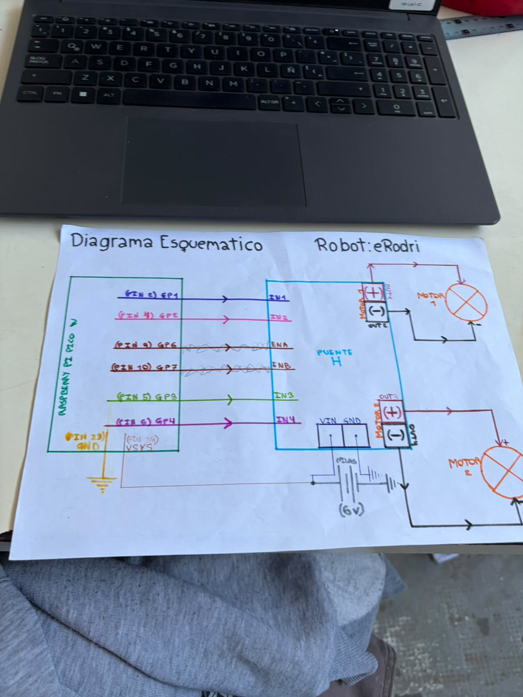
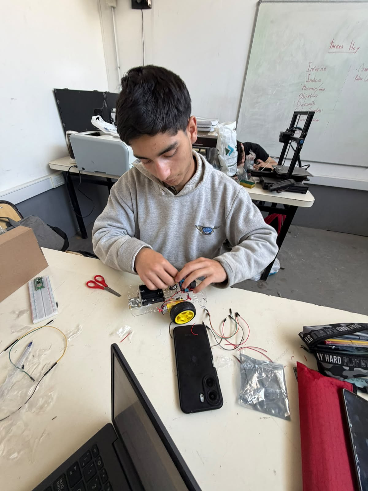
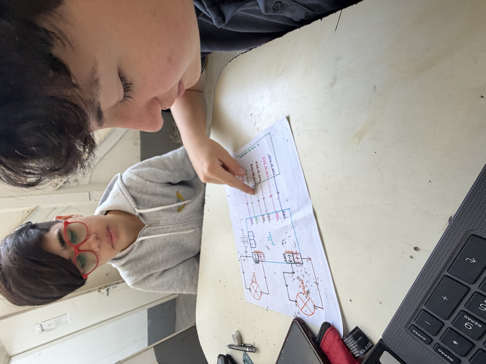

NOTA: A medida que se realizan las bitácoras deberán ser subidas al repo correspondiente

# BITÁCORA DE PROYECTO – ROBOT SUMO

## Equipo: _____Los Rodri Stones______
## Nombre del Robot: __eRodri______
## Capitán: ____Lautaro Rodriguez_______
## Subcapitán: _____Rodriguez F. Santino_____
## Integrantes:
-Lautaro Rodriguez
-Santino Rodriguez F.
-Faustino Puerta
-Tomas Sofia 
-Ramiro Sosa

## REGISTRO DE ACTIVIDADES
### Fecha: 19/10
### Integrantes presentes:
-Lautaro Rodriguez
-Santino Rodriguez F.
-Faustino Puerta
-Tomas Sofia 
-Ramiro Sosa

### Objetivos de la jornada:
-Terminar la estructura del robot
-Terminar el sistema esquematico 
-Pasar el codigo a la raspberry mediante la protoboard

### Actividades realizadas:
-implementamos la protoboard al robot
-terminamos el diagrama esquematico
-

### Problemas encontrados:
-Falta de componentes
-no habiamos terminado el codigo
-

### Soluciones implementadas o propuestas:
-tratamos de conseguir los componentes faltantes pero no conseguimos
-lo pudimos terminar
-

### Pruebas realizadas:
-
-
-

### Resultados obtenidos:
-
-
-

### Fotografías, diagramas o evidencias: (Adjuntar imágenes, capturas de pantalla o esquemas)

### Tareas pendientes:
-funcionamiento del robot
-
-

### APORTES INDIVIDUALES
Integrante: ___Lautaro Rodriguez_______

Tarea realizada:se enfoco en el desarrollo del codigo 

Integrante: ____Santino Rodriguez F. ______

Tarea realizada:se enfoco en el desarrollo del diagrama esquematico

Integrante: ____Faustino Puerta______

Tarea realizada:participó en la implementacion de la protoboard,ayudó en la busqueda de errores del diagrama esquematico y realizó la bitacora de la fecha

Integrante: ____Sofia Tomas_______

Tarea realizada:se enfocó en la implementacion de la protoboard, realizo una profunda busqueda de errores en el codigo sin encontrar ninguno y busqueda de componentes 

Integrante: ____Ramiro Sosa_______

Tarea realizada:realizo la estructura electronica del robot y busqueda de componentes
